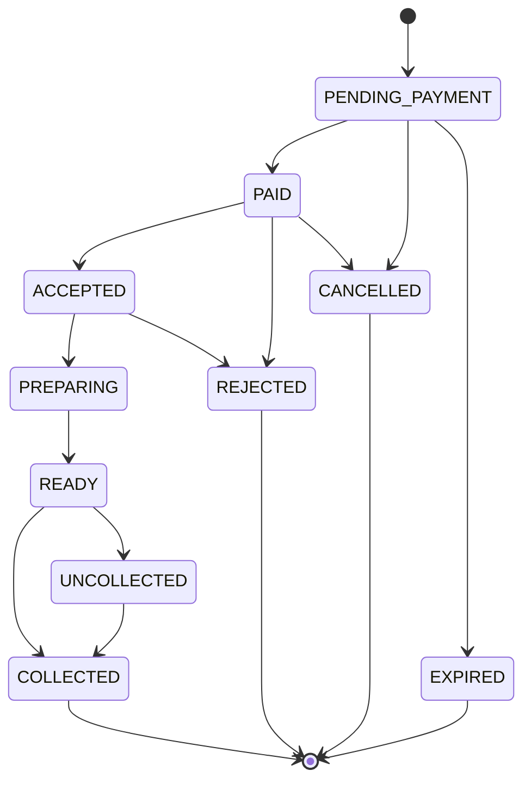

# Smart Campus Food Ordering System — Backend

A modular monolith backend for campus food ordering: students browse vendor menus, place orders, pay, track live, and collect with a pickup code/QR. Vendors manage menus and an order board. Admins handle vendors, complaints, payment disputes, and analytics.

## Tech Stack
- **Java 21**, **Spring Boot 4.x**, **Maven**
- PostgreSQL + Flyway, Redis, RabbitMQ (optional), Firebase Admin SDK
- JWT (jjwt 0.12.x), Spring Security, springdoc-openapi 2.8.x
- Testcontainers, JUnit 5

---

## Package Map & Allowed Dependencies

```
com.smartcampus/
├── common/                     # Shared infra: config, security, exceptions, DTOs, util
│   ├── config/                 # OpenApiConfig, RedisConfig, RabbitConfig, AsyncConfig, ClockConfig
│   ├── security/               # SecurityConfig, JwtService, JwtAuthFilter, CurrentUser
│   ├── exception/              # ApiException, NotFoundException, ConflictException, ForbiddenException, GlobalExceptionHandler
│   ├── dto/                    # ApiError, PageResponse
│   └── util/                   # TokenGenerator, RateLimiter
├── auth/                       # Registration, login, token refresh, password reset (Implemented)
│   └── dto/                    # RegisterRequest, LoginRequest, AuthResponse, etc.
├── user/                       # User entity, repository, service, controller (Implemented)
│   └── dto/                    # UserProfileResponse, UpdateUserRequest
├── vendor/                     # Vendor entity, types, settings, busy meter
│   └── dto/                    # VendorResponse, CreateVendorRequest, UpdateVendorRequest
├── menu/                       # MenuItem entity, stock management, availability
│   ├── dto/                    # MenuItemStudentResponse, MenuItemVendorResponse, EtaRange
│   └── events/                 # MenuItemUpdated
├── order/                      # Order lifecycle, payments resolution, slots, pickup, jobs, estimates
│   ├── dto/                    # CreateOrderRequest, OrderResponse, PayOrderResponse, etc.
│   └── events/                 # OrderStatusChanged (fixed), OrderEtaUpdated
├── payment/                    # Payment entity, gateway interface, mock, reconciliation, webhook, admin
│   ├── dto/                    # PaymentResponse, PaymentIssueResponse, ManualRefundRequest, etc.
│   └── events/                 # PaymentRefunded
├── notify/                     # SSE registry, push notifications (FCM), device tokens
│   └── dto/                    # RegisterDeviceRequest
├── complaint/                  # Complaint entity, student filing, admin review
│   └── dto/                    # CreateComplaintRequest, ComplaintResponse
├── analytics/                  # Vendor and admin analytics, audit log endpoints
│   └── dto/                    # VendorAnalyticsResponse, AdminAnalyticsResponse
└── audit/                      # AdminAction entity, AuditService (depends on nothing)
```

### Dependency Direction (one-way only)

| Module | May depend on |
|--------|---------------|
| `common` | — |
| `audit` | — |
| `user` | `common` |
| `auth` | `common`, `user` |
| `vendor` | `common`, `user` |
| `menu` | `common`, `vendor` |
| `payment` | `common`, `user` |
| `order` | `common`, `menu`, `vendor`, `payment` |
| `notify` | `common`, `order`, `vendor`, `payment` |
| `complaint` | `common`, `order`, `payment` |
| `analytics` | `common`, `vendor`, `order`, `audit` |

> [!IMPORTANT]
> **menu, vendor, and payment must NEVER import order.** Cross-module needs are handled via interfaces:
> - `menu.EtaProvider` → implemented by `order.EstimateService`
> - `vendor.VendorLoadReader` → implemented by `order.EstimateService`
> - `payment.PaymentOutcomeHandler` → implemented by `order.OrderPaymentResolver`

---

## Order State Machine



---

## Payment Outcome Table (Section 5.3)

| Gateway Result | Payment Status | Order Status | Stock | HTTP |
|---------------|---------------|-------------|-------|------|
| SUCCESS | SUCCESS | → PAID (pickup code generated) | kept | 200 |
| Definite DECLINE | FAILED | → CANCELLED | restored once | 402 |
| Timeout / network error | UNCONFIRMED | stays PENDING_PAYMENT | **KEPT** held | 202 |

---

## Edge Case Table (Section 5 — Business Rules)

| # | Situation | Behaviour |
|---|-----------|-----------|
| 5.1a | Student has ≥ max-unpaid-per-student orders in PENDING_PAYMENT | 409 TOO_MANY_UNPAID_ORDERS |
| 5.1b | Student exceeds rate limit for POST /orders | 429 RATE_LIMITED with Retry-After |
| 5.1c | Vendor is closed or suspended | 409 VENDOR_CLOSED / VENDOR_SUSPENDED |
| 5.1d | Item does not belong to the vendor or is unavailable | 400 ITEM_UNAVAILABLE |
| 5.1e | Quantity < 1 or > max-qty-per-item | 400 VALIDATION_ERROR |
| 5.1f | Pickup slot is full (0 rows updated) | 409 SLOT_FULL |
| 5.1g | Stock insufficient for any item | 409 OUT_OF_STOCK (whole TX rolls back) |
| 5.1h | Duplicate items in cart | Merged into single line |
| 5.1i | Items processed in ascending menu_item_id order | Prevents deadlocks |
| 5.2a | Stock decrement | ONE conditional SQL per item; never read-then-write in Java |
| 5.2b | Stock restore | Exactly ONCE, guarded by conditional order status update |
| 5.2c | Two students buying last unit | DB serializes; one succeeds, other gets OUT_OF_STOCK before payment |
| 5.2d | "Available" in DTOs | is_available AND stock_qty > 0; lowStock = stock ≤ threshold |
| 5.3a | /pay on UNCONFIRMED payment | Returns 202 again, no second charge |
| 5.3b | Hold expired before /pay | 409 HOLD_EXPIRED |
| 5.4a | PaymentOutcomeHandler receives duplicate outcome | No-op (conditional update returns 0) |
| 5.4b | Late SUCCESS after order EXPIRED or CANCELLED | Records SUCCESS, auto-refunds, does NOT revive order |
| 5.4c | FAILED and order PENDING_PAYMENT | CANCELLED, stock+slot restored once |
| 5.5a | Webhook with invalid/missing signature | 401 Unauthorized |
| 5.5b | Duplicate webhook event_id | 200 no-op |
| 5.5c | UNCONFIRMED payment at reconciliation | Gateway queried; UNKNOWN increments check_count |
| 5.5d | REFUND_FAILED at reconciliation | Retried up to refund-max-attempts |
| 5.5e | Expiry job finds UNCONFIRMED payment | Skips order until unconfirmed-max-minutes cap |
| 5.6a | Student cancels PENDING_PAYMENT + UNCONFIRMED payment | 409 PAYMENT_UNCONFIRMED |
| 5.6b | Student cancels PENDING_PAYMENT (no charge in flight) | CANCELLED, stock+slot restored |
| 5.6c | Student cancels PAID | Refund (CANCELLED reason), stock+slot restored |
| 5.6d | Student cancels after ACCEPTED | Not allowed |
| 5.6e | Vendor rejects PAID or ACCEPTED | Refund (REJECTED reason), stock restored |
| 5.6f | Refund fails at gateway | REFUND_FAILED, appears in admin issues, retried by recon job |
| 5.7a | Same idempotency key + same payload | Returns existing order (200, Idempotent-Replayed: true) |
| 5.7b | Same idempotency key + different payload | 409 IDEMPOTENCY_KEY_REUSED |
| 5.7c | Two identical requests race | Catch unique-violation, return existing order |
| 5.9a | Token registered under another user | Moved to current user |
| 5.9b | Max tokens per user exceeded | Oldest deleted |
| 5.9c | Push ACCEPTED while student has SSE stream open | Push skipped |
| 5.9d | Push failure | Never fails order; INVALID_TOKEN deletes that token |
| 5.9e | Push content | No pickup code or amounts on lock screen |
| 5.10a | Redis unavailable during order rate limit | Fail open (allow, log warning) |
| 5.10b | Redis unavailable during login rate limit | Fail closed (block) |
| 5.11a | READY for > reminder-minutes without reminder | Send reminder once (set reminder_sent_at) |
| 5.11b | READY for > flag-minutes | UNCOLLECTED (no refund, no stock restore) |
| 5.11c | Student arrives late for UNCOLLECTED | POST pickup/verify → COLLECTED |
| 5.11d | Admin refund for UNCOLLECTED | POST /admin/payments/{id}/refund reason=UNCOLLECTED_OVERRIDE |
| 5.12a | Admin retry-refund on non-REFUND_FAILED | 409 REFUND_NOT_ALLOWED |
| 5.12b | Refund idempotency | Gateway reference refund-{paymentId}; conditional update; retry is no-op |
| 5.12c | Admin resolve UNCONFIRMED | Only if older than unconfirmed-max-minutes |
| 5.12d | Every admin money action | Writes admin_actions row via AuditService |
| 5.13a | Forgot-password for unknown email | Same 200 response (no account discovery) |
| 5.13b | Token lookup | By SHA-256 hash only; raw token never stored |
| 5.13c | Expired/used/unknown reset token | Same 400 INVALID_RESET_TOKEN |
| 5.13d | Successful password reset | Sets password_changed_at; all prior JWTs rejected |
| 5.13e | Admin vendor password reset | Also sets password_changed_at |

---

## ETA Rules (Section 6)

| Step | Formula |
|------|---------|
| **ownMinutes** | max(prep_minutes among items) + min(5, distinct_items − 1) |
| **backlogMinutes** | Σ ownMinutes for orders in PAID, ACCEPTED, PREPARING (PREPARING: subtract elapsed since preparing_at, ≥ 0) |
| **queueWait** | backlogMinutes / parallel_capacity. If rush_mode: + rush-extra-minutes |
| **estimate** | queueWait + ownMinutes |
| **Range** | low = ⌈estimate⌉, high = ⌈estimate × range-factor⌉ + 1 (high always > low) |
| **Busy Level** | queueWait < busy-threshold → CALM; < packed-threshold → BUSY; else → PACKED |
| **Caching** | Redis 15s for list screens; fresh from DB at order placement |
| **Recompute** | On vendor order set change; publish OrderEtaUpdated if range moved ≥ 2 min |

---

## Endpoint Table (Section 7)

| Method | Path | Role | Description | Status |
|--------|------|------|-------------|--------|
| POST | `/auth/register` | Public | Register new user | `201 Created` |
| POST | `/auth/login` | Public | Login (rate limited per IP & email) | `200 OK` |
| POST | `/auth/refresh` | Public | Refresh active JWT | `200 OK` |
| POST | `/auth/forgot-password` | Public | Request password reset email (rate limited) | `200 OK` |
| POST | `/auth/reset-password` | Public | Reset password using SHA-256 token | `200 OK` |
| GET | `/users/me` | Authenticated | Get current user profile | `200 OK` |
| PATCH | `/users/me` | Authenticated | Update current user profile | `200 OK` |
| POST | `/payments/webhook` | Public | Payment gateway webhook (HMAC verified) | `200 OK` |
| POST | `/devices` | Authenticated | Register push notification token | `200 OK` |
| DELETE | `/devices/{token}` | Authenticated | Unregister push token | `200 OK` |
| GET | `/vendors` | Public | List all vendors (with busyLevel, estimatedWaitMinutes) | `200 OK` |
| GET | `/vendors/{id}` | Public | Get vendor details | `200 OK` |
| GET | `/vendors/{id}/menu` | Public | Get menu (per-item ETA under current load) | `200 OK` |
| GET | `/vendors/{id}/slots?date=` | Public | Available pickup slots | `200 OK` |
| GET | `/vendors/{id}/menu/events` | Public | SSE: menu-item-update events | `200 OK` |
| POST | `/orders` | STUDENT | Place order (Idempotency-Key header required) | `200 OK` / `201` |
| POST | `/orders/{id}/pay` | STUDENT | Pay for order | `200` / `202` / `402` |
| GET | `/orders/me` | STUDENT | My orders | `200 OK` |
| GET | `/orders/{id}` | STUDENT/VENDOR/ADMIN | Order details | `200 OK` |
| GET | `/orders/{id}/pickup` | STUDENT | Pickup code and QR secret | `200 OK` |
| POST | `/orders/{id}/cancel` | STUDENT | Cancel order | `200 OK` |
| POST | `/orders/{id}/reorder` | STUDENT | Re-place a previous order (optional) | `200 OK` |
| GET | `/orders/{id}/events` | STUDENT | SSE: order status & ETA events | `200 OK` |
| POST | `/complaints` | STUDENT | File a complaint | `200 OK` / `201` |
| GET | `/complaints/me` | STUDENT | My complaints | `200 OK` |
| GET | `/vendor/me` | VENDOR | My vendor profile | `200 OK` |
| PATCH | `/vendors/{id}` | VENDOR/ADMIN | Update vendor settings | `200 OK` |
| GET | `/vendor/menu` | VENDOR | My menu items (with exact stock) | `200 OK` |
| POST | `/menu-items` | VENDOR | Create menu item | `201 Created` |
| PUT | `/menu-items/{id}` | VENDOR | Update menu item | `200 OK` |
| PATCH | `/menu-items/{id}/availability` | VENDOR | Toggle availability | `200 OK` |
| PATCH | `/menu-items/{id}/stock` | VENDOR | Set stock quantity | `200 OK` |
| DELETE | `/menu-items/{id}` | VENDOR | Delete menu item | `204 No Content` |
| GET | `/vendor/orders?status=` | VENDOR | Orders for my shop | `200 OK` |
| GET | `/vendor/orders/stream` | VENDOR | SSE: live order board | `200 OK` |
| PATCH | `/orders/{id}/status` | VENDOR | Advance order status | `200 OK` |
| POST | `/orders/pickup/verify` | VENDOR | Verify pickup (code or QR) | `200 OK` |
| GET | `/vendor/analytics?from=&to=` | VENDOR | Shop analytics | `200 OK` |
| POST | `/admin/vendors` | ADMIN | Create vendor | `201 Created` |
| GET | `/admin/vendors` | ADMIN | List all vendors | `200 OK` |
| PATCH | `/admin/vendors/{id}` | ADMIN | Update vendor | `200 OK` |
| POST | `/admin/vendors/{id}/reset-password` | ADMIN | Reset vendor password | `200 OK` |
| GET | `/admin/complaints?status=` | ADMIN | Complaints inbox | `200 OK` |
| PATCH | `/admin/complaints/{id}` | ADMIN | Update complaint status | `200 OK` |
| GET | `/admin/payments/issues` | ADMIN | Unresolved payment issues | `200 OK` |
| POST | `/admin/payments/{id}/retry-refund` | ADMIN | Retry failed refund | `200 OK` |
| POST | `/admin/payments/{id}/resolve` | ADMIN | Manually resolve payment issue | `200 OK` |
| POST | `/admin/payments/{id}/refund` | ADMIN | Manual full refund (COMPLAINT / UNCOLLECTED_OVERRIDE) | `200 OK` |
| GET | `/admin/actions` | ADMIN | Audit log | `200 OK` |
| GET | `/admin/orders` | ADMIN | All orders (optional) | `200 OK` |
| GET | `/admin/analytics` | ADMIN | Campus-wide analytics | `200 OK` |

---

## Authentication & User Profile API

### 1. Register User
- **`POST /auth/register`**
- **Public access**

**Request Body:**
```json
{
  "name": "Arun Kumar",
  "email": "arun@student.edu",
  "password": "Password123",
  "role": "STUDENT"
}
```

**Response (`201 Created`):**
```json
{
  "token": "eyJhbGciOiJIUzI1NiIsIn...",
  "tokenType": "Bearer",
  "expiresInSeconds": 3600,
  "user": {
    "id": 1,
    "name": "Arun Kumar",
    "email": "arun@student.edu",
    "role": "STUDENT",
    "createdAt": "2026-10-17T12:00:00Z"
  }
}
```

### 2. Login
- **`POST /auth/login`**
- **Public access** (Rate-limited at `app.auth.rate-limit-per-minute` per IP and per email)

**Request Body:**
```json
{
  "email": "arun@student.edu",
  "password": "Password123"
}
```

**Response (`200 OK`):**
```json
{
  "token": "eyJhbGciOiJIUzI1NiIsIn...",
  "tokenType": "Bearer",
  "expiresInSeconds": 3600,
  "user": {
    "id": 1,
    "name": "Arun Kumar",
    "email": "arun@student.edu",
    "role": "STUDENT",
    "createdAt": "2026-10-17T12:00:00Z"
  }
}
```

### 3. Refresh Token
- **`POST /auth/refresh`**
- **Public access**

**Request Body:**
```json
{
  "refreshToken": "eyJhbGciOiJIUzI1NiIsIn..."
}
```

### 4. Forgot Password
- **`POST /auth/forgot-password`**
- **Public access** (Rate-limited, fails closed on Redis error)
- Always returns the identical 200 response whether the email exists or not to prevent account discovery:

**Request Body:**
```json
{
  "email": "arun@student.edu"
}
```

**Response (`200 OK`):**
```json
{
  "message": "If the email is registered, a password reset link has been sent."
}
```

### 5. Reset Password
- **`POST /auth/reset-password`**
- **Public access**
- Unknown, expired, and already used tokens return `400 INVALID_RESET_TOKEN`.
- Updates password hash and `password_changed_at`, invalidating all previous JWTs.

**Request Body:**
```json
{
  "token": "<url-safe-token-from-email>",
  "newPassword": "NewStrongPassword123"
}
```

### 6. Current User Profile
- **`GET /users/me`** (Requires `Authorization: Bearer <token>`)
- **`PATCH /users/me`** (Requires `Authorization: Bearer <token>`)

---

## Mock Payment Gateway (dev only)

Activated via `app.payment.mock.magic-amounts=true`.

| Total ends in (paise) | Behaviour |
|---|---|
| Any other value | Immediate SUCCESS |
| .01 | Definite DECLINE |
| .02 | UNKNOWN now → SUCCESS after 20s (simulates delayed webhook) |
| .03 | UNKNOWN now → FAILED after 20s |
| .04 | UNKNOWN now → SUCCESS after 310s (after hold expires → late success, must be auto-refunded) |
| .05 | Immediate SUCCESS, but refund call fails (REFUND_FAILED) |

---

## Seed Data (dev profile only)

| Role | Email | Password |
|------|-------|----------|
| Admin | `admin@campus.edu` | `Admin@123` |
| Vendor (Main Canteen) | `canteen@campus.edu` | `Vendor@123` |
| Vendor (Rishabs) | `rishabs@campus.edu` | `Vendor@123` |
| Vendor (Metro Cafe) | `metro@campus.edu` | `Vendor@123` |
| Student | `arun@student.edu` | `Student@123` |
| Student | `priya@student.edu` | `Student@123` |

---

## Running

```bash
# Prerequisites: PostgreSQL, Redis running locally

# Linux / macOS
./mvnw spring-boot:run -Dspring-boot.run.profiles=dev
./mvnw -q compile
./mvnw test

# Windows (PowerShell / Command Prompt)
.\mvnw.cmd spring-boot:run -Dspring-boot.run.profiles=dev
.\mvnw.cmd -q compile
.\mvnw.cmd test
```

---

## Assumptions & Decisions

1. **Spring Boot 4.x compatibility**: `@EntityScan` was removed in Spring Boot 4; entity scanning relies on `@SpringBootApplication(scanBasePackages)` and `@EnableJpaRepositories(basePackages)`.
2. **Single currency**: All prices are in INR. No multi-currency support.
3. **No file uploads**: Menu item `image_url` is a URL string; image hosting is external.
4. **Refresh token**: `POST /auth/refresh` is declared but marked optional; the primary flow uses short-lived JWTs.
5. **Full refunds only**: Partial refunds are explicitly out of scope per specification.
6. **Reorder endpoint**: `POST /orders/{id}/reorder` is declared but optional; it re-creates a new order from a previous one's items.
7. **Admin orders endpoint**: `GET /admin/orders` is declared but optional.
8. **Vendor analytics date range**: When `from`/`to` are not provided, defaults to the last 30 days (to be decided during implementation).
9. **Clock bean**: All time operations use an injected `java.time.Clock` bean so tests can freeze or advance time.
10. **CORS origins**: Configured for `localhost:3000` (React dev), `localhost:8081/19000/19006` (Expo), and `exp://*`.
